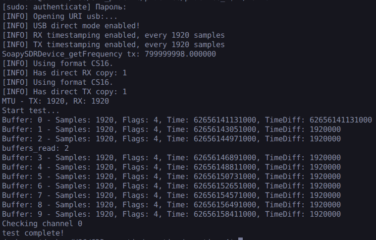
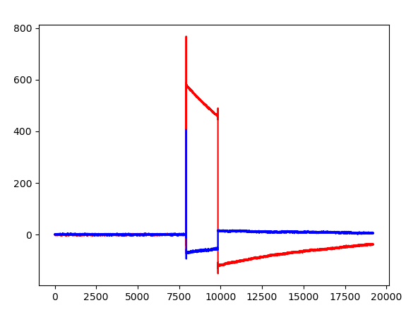

# Практика 3 - Знакомство с библиотеками Soapy SDR, Libio для работы с Adalm Pluto SDR. Инициализация SDR-устройства. Работа с буфером: получение цифровых IQ-отсчетов.

Удалось cобрать код преподавателя и запустить его. Получить с одного SDR (антенны TX -> RX) данные и визуализировать с помощью файла [test_seccess.py](../practice_4/test/test_success.py)

  

  

